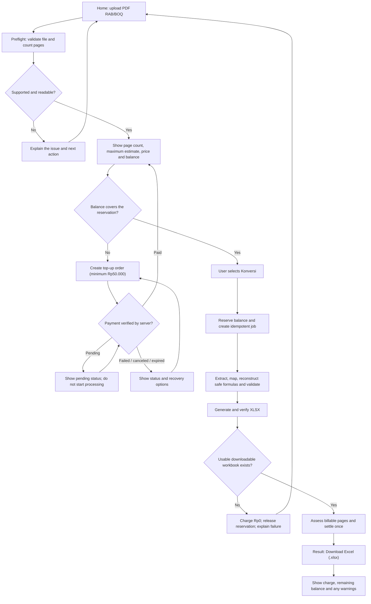

# Application Flow Specification — RabConverter

Status: target product behavior for the MVP; not proof of an implemented application.
UX benchmark: remove.bg, used only for interaction simplicity—not its technology, brand assets, or business model.
Commercial and provider rules remain governed by [pricing-and-billing.md](pricing-and-billing.md) and [processing-pipeline.md](processing-pipeline.md).

## 1. Product experience in one sentence

**Upload a RAB/BOQ PDF, let RabConverter do the work, then download an editable Excel workbook.**

The user should not need to learn extraction, mapping, formula reconstruction, provider, wallet-ledger, or settlement terminology. Those are application responsibilities. The interface exposes only the information and choices needed to start safely, understand an exception, and obtain the result.

## 2. UX rules that are requirements

1. **One primary action:** the initial screen is centered on uploading a PDF. Do not make a dashboard, feature tour, or configuration form a prerequisite for the first conversion.
2. **One continuous conversion journey:** upload, price confirmation, processing, and result should live in one clear flow. Use inline panels or a focused dialog when practical; do not create a wizard step for every backend stage.
3. **Automate the normal path:** after the user confirms the displayed cost ceiling and starts conversion, the system validates, extracts, maps, reconstructs safe formulas, checks the workbook, assesses billable pages, and settles automatically.
4. **Interrupt only for a real reason:** ask the user to act only for an unsupported file, insufficient balance, an important ambiguity that cannot be represented safely, or another issue that blocks a usable deliverable. Do not force a full-table review on every successful conversion.
5. **Result first:** once a valid workbook is ready, make **Download Excel (.xlsx)** the dominant action. Warnings and advanced details remain visible but secondary; do not hide a ready file behind a mandatory tour or dashboard.
6. **No silent invention:** preserve printed source values. Never invent rates, quantities, taxes, overhead, profit, or formula logic. An uncertainty that can be preserved safely should become a targeted warning, not a fabricated answer.
7. **Clear price before paid work:** show page count, price, estimated maximum, wallet balance, and any shortfall before provider processing begins. The user explicitly starts paid processing. Do not surprise-charge.
8. **Truthful status:** progress labels reflect real backend states. Never fake percentages, imply that a stage is finished early, or promise a specific processing time that the system cannot support.
9. **Recover without starting over:** a payment or recoverable processing issue should return the user to the relevant state with the file/job context retained where safely possible.
10. **Mobile is a first-class path:** upload, start, status, warning summary, and download work on a narrow screen without requiring a desktop-only table interaction.
11. **No false live claims:** QRIS, a payment gateway, background workers, provider execution, and downloadable files are not presented as available until implemented and verified.

## 3. Main conversion flow

### Normal path, step by step

1. The home screen offers one prominent upload action: drag and drop or choose a PDF. It states the supported input and the per-page price without overwhelming the user with the complete billing policy.
2. Preflight validates file type, readability, encryption, configured size/page limits, and source page count. Unsupported or invalid documents receive a plain-language explanation and a useful recovery action.
3. Before any paid provider processing, show a compact cost panel: source page count, Rp2.500/page, estimated maximum charge, available balance, and required top-up if the balance is insufficient. Explain that final charge depends on qualifying pages retained in the successful workbook.
4. When balance is sufficient, the user explicitly selects **Konversi PDF**. The server checks the balance and creates the reservation/job atomically and idempotently. The browser is not authoritative for balance or price.
5. The interface stays on the conversion journey and shows meaningful stages: validating → reading pages → extracting tables → mapping RAB rows → reconstructing safe formulas → checking totals → preparing Excel. Show only real stages and honest retry states.
6. The server verifies that the XLSX can be opened and meets the workbook contract, then assesses billable source pages from records actually retained in the export.
7. If a downloadable workbook exists, the server performs one idempotent settlement, releases the unused reservation, and presents the result. If no usable deliverable exists, the charge is Rp0 and the reservation is released.
8. The result screen leads with **Download Excel (.xlsx)**. It also shows billable pages × Rp2.500, actual charge, remaining balance, job/receipt reference, and any relevant warnings. Warnings must not obscure or disable a usable download without a specific correctness reason.

## 4. Review is exception-driven, not a mandatory step

The target experience must not require every customer to inspect every extracted row before receiving a workbook.

- **No material uncertainty:** generate and offer the workbook directly.
- **Uncertainty that can be preserved safely:** keep the printed value, leave speculative formulas out, mark the affected cell/row, and include a specific warning with source-page provenance. The workbook can still be offered when it meets the export contract.
- **High-impact ambiguity that truly blocks a safe result:** ask one focused, contextual question about the affected field or mapping. Explain what decision is needed and provide safe choices such as keeping the printed value or leaving the formula unresolved. Do not silently assume a tax, overhead, rate, or formula rule.
- **Partial extraction:** offer a partial workbook only when the product can clearly describe its limitations and the artifact meets the approved export contract. Bill only qualifying pages represented in that artifact.
- **No usable RAB/BOQ records or failed export:** do not present the job as a successful conversion. Explain why there is no download; charge Rp0 and release the reservation.

A warning by itself does not make a page non-billable. Billability is determined by the source-page contribution rules in [pricing-and-billing.md](pricing-and-billing.md), not by a warning count or provider usage.

## 5. Top-up flow

Top-up is a recovery branch of the same conversion journey, not a separate funnel that makes the user upload the PDF again.

1. Create an order for an amount of at least Rp50.000.
2. Display the order amount, order reference, payment instructions from the selected provider, and persisted status.
3. Treat the order as pending until a server-verified payment event confirms settlement. Browser redirects or screenshots alone never credit the wallet.
4. For pending payments, show that processing has not started and provide a way to refresh/check status. Do not create repeated orders or claim a successful credit from a redirect parameter.
5. On verified success, credit the wallet once, return to the retained conversion context, refresh the estimate/balance, and let the user press **Konversi PDF** to start. Do not silently begin paid processing after payment.
6. For failed, canceled, or expired orders, explain the status and let the user retry or leave. An ambiguous provider state is marked as needing reconciliation, not falsely marked paid.
7. QRIS is a preferred method to evaluate, not a live option until the provider integration is built and tested.

## 6. User-visible state model

These are user-facing semantic states. Backend enum names may differ, but each state must map to a clear label and action.

| State | What the user sees | Required behavior |
|---|---|---|
| Ready to upload | One main upload action and concise price cue | No prerequisite dashboard |
| File checking | Validation and page count being determined | No paid processing yet |
| File rejected | Plain-language reason and corrective action | No charge |
| Estimate ready | Pages, maximum estimate, balance, and explicit start action | Do not start provider until confirmed |
| Balance insufficient | Exact shortfall and top-up action | Do not process or reserve beyond policy |
| Payment pending | Persisted pending status | Do not credit or process |
| Payment confirmed | Updated balance and return to conversion | User explicitly starts conversion |
| Processing | Real processing stage/status | Bounded visible retries; prevent duplicate jobs |
| Needs user input | One specific ambiguity and source context | Do not invent a value |
| Completed with warnings | Download available plus concise warning summary | Warning does not automatically block a usable artifact |
| Completed | Download action, final charge and balance | One charge per job |
| No usable result | Clear reason and retry/re-upload action | Rp0 charge; reservation released |
| Processing/export failed | Safe error and recovery path | If no artifact exists: Rp0 charge; reservation released |
| Settlement/reconciliation issue | Clear non-success payment state and reference | Never claim a false charge or top-up success |

## 7. Screen and component boundary

The smallest useful first-release experience is:

- **Conversion home:** upload area, one-sentence promise, PDF-only scope, price cue, and a quiet route to balance/history/account details where applicable.
- **Estimate panel:** page count, maximum charge, current balance, shortfall or reservation information, and the single start/top-up action.
- **Processing state:** one real status line plus stage details that can be expanded when helpful; no dashboard widgets or fake progress.
- **Result state:** dominant download action, concise billing receipt, remaining balance, and warnings that matter.
- **Focused exception panel:** appears only when a concrete user decision is needed.
- **Top-up status panel:** order details and persisted payment status; returns to the same conversion context.

History, deep audit details, full-row browsing, transaction ledgers, and account settings may exist as secondary destinations. They must not compete with the first conversion action.

## 8. Acceptance scenarios

The UX and implementation are not accepted until these scenarios are covered by deterministic tests and manual desktop/mobile inspection:

1. **Successful common case:** a supported PDF with sufficient balance reaches a valid XLSX through one continuous flow; the download is prominent and the displayed charge matches the ledger.
2. **Insufficient balance:** no extraction provider is called before funds are sufficient; the top-up order is verified server-side; after payment the user returns to the same conversion and explicitly starts it.
3. **Invalid or unsupported input:** the reason and next action are clear; no customer charge occurs.
4. **Recoverable provider failure:** bounded retries are visible and idempotent; a job with no downloadable artifact is charged Rp0 and the reservation is released.
5. **Useful partial output:** a valid completed-with-warnings workbook can be downloaded; warnings are specific; only qualifying exported pages are charged.
6. **Formula uncertainty:** printed values are preserved; unsupported formula assumptions are not invented; the user is not forced through a full-document review if an honest workbook can be safely generated.
7. **Export failure:** no download is offered, no customer page charge is taken, and the reservation is released.
8. **Duplicate requests/callbacks:** processing, top-up credits, and charges are not duplicated.
9. **Mobile conversion:** upload, cost confirmation, live state, result, warnings, and download remain usable at narrow viewport widths.
10. **Truthful product status:** no provider, payment option, or infrastructure is shown as operational before it has been implemented and verified.

## 9. Relationship to other specifications

- [product-definition.md](product-definition.md) owns the product promise and scope.
- [pricing-and-billing.md](pricing-and-billing.md) owns the price, billable-page definition, reservations, top-up lifecycle, charge, reversal, and COGS.
- [processing-pipeline.md](processing-pipeline.md) owns backend stages, provider behavior, validation, retry and artifact generation.
- [user-experience.md](user-experience.md) owns screen-level interaction, visual hierarchy, accessibility and UI details.
- [export-specification.md](export-specification.md) owns the XLSX contract.
- [acceptance-criteria.md](acceptance-criteria.md) owns the testable product and engineering gates.

If implementation choices conflict with the simplicity rules here, simplify the interaction—not the underlying billing integrity, output correctness, or honest handling of uncertain source data.
