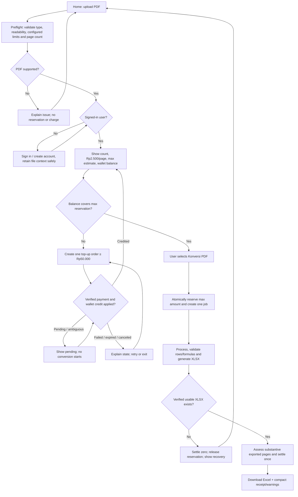

# Application Flow Specification — RabConverter

Status: source of truth for target MVP user experience and user-visible job/payment transitions; this is not proof of implementation.
UX benchmark: remove.bg interaction simplicity only—one main upload action, automatic work, a clear result, and easy download. Do not copy its technology, brand assets, or business model.
Pricing/billability rules are owned exclusively by [pricing-and-billing.md](pricing-and-billing.md); technical pipeline by [processing-pipeline.md](processing-pipeline.md); workbook rules by [export-specification.md](export-specification.md).

## 1. Product loop

**Unggah PDF RAB/BOQ → sistem mengerjakan konversi → unduh XLSX.**

The user should not need to understand extraction, row mapping, formula reconstruction, queue, wallet ledger or settlement. Those are system responsibilities. The interface displays the cost ceiling, actual state, result and any decision genuinely needed to make the result safe. Do not add a queue pre-emptively. If runtime limits later require one, create the job/reservation in the database first, commit, dispatch separately, and recover any committed job whose dispatch failed.

## 2. Non-negotiable UX contract

1. One primary action on the first screen: upload a PDF.
2. Preflight and price estimate stay in the same conversion journey; do not create a page for each backend stage.
3. No dashboard, feature tour or full-document review is required before the first usable download.
4. Paid processing starts only after the server confirms an authenticated user, explicit conversion intent and an atomic reservation.
5. Normal-case conversion automatically proceeds through extraction, validation, XLSX generation, billable-page assessment and settlement.
6. Review is exception-driven: preserve uncertainty safely and warn; ask a targeted question only when a material decision is necessary.
7. A valid XLSX is result-first. Show “Download Excel (.xlsx)” as the dominant action.
8. Never make up data, formula rules, status, progress percentages, costs or payment success.
9. A job can be left, retried or recovered without creating duplicate charges/credits. Durable work may continue after navigation only once implemented and verified.
10. Do not add components or dependencies just to mirror each conceptual stage. Prefer one job record, one wallet/ledger contract, one queue if a durable async queue is required, and simple inline UI states.

## 3. Main conversion flow

## 4. Main path rules

### Home and preflight
- Offer drag/drop and browse with PDF RAB/BOQ scope, concise privacy notice, and price cue.
- Validate MIME/file signature, readability, encryption/corruption and configured byte/page limits before any paid provider call.
- Preflight may run before login, but customer-owned source files must be kept only in an explicitly temporary, private context. The simplest default is to request sign-in before storing a durable job or retaining the file in server storage.
- After a user signs in, confirm the temporary upload can be safely associated with that identity; otherwise ask them to reselect the file. Never expose temporary uploads through public URLs.

### Estimate and explicit start
- Show source page count, Rp2.500/page, estimated maximum, available wallet balance, and exact shortfall.
- Maximum = all accepted source pages × price; it is a reservation ceiling, not a promise of final billing.
- Top-up minimum Rp50.000 is a minimum transaction, never a minimum job charge.
- Do not call Reducto before server-side auth, explicit **Konversi PDF** intent and successful atomic reservation.
- A repeated submit for the same intent returns the same job/result and does not create a second job charge.

### Automatic conversion
- Show only real states: checking PDF → reading pages → extracting tables → organizing RAB rows → checking formulas/totals → preparing Excel.
- These are labels for real backend milestones, not a simulated percentage timer.
- After output verification, deterministically assess billable pages from records in the export manifest, calculate one charge against the job's price snapshot, and release remaining reservation atomically.
- If no valid downloadable XLSX exists, charge Rp0 and release the full reservation. A warning is not itself a reason to call a page non-billable.

### Review only when necessary
- No material ambiguity: continue automatically to export.
- Ambiguity that can safely remain unresolved: preserve source values, leave unsubstantiated formulas absent, add a source-linked warning, and offer the workbook if the export contract is met.
- Only block on a focused user choice when the uncertainty prevents an honest usable workbook. Do not invent tax, overhead, profit, rates, quantity, or formula membership.
- Correcting data before the first export does not create another job. Regeneration after an export creates a new immutable artifact version in the same job; it must not create a second job charge. Settlement may be adjusted only through a documented compensating ledger entry if the final billable assessment changes due to a confirmed correction.

## 5. Payment and top-up transitions

- State machine: `created → pending → paid → credited`; terminal alternatives are `failed`, `canceled`, `expired`, and `reconciliation_required`. Exact provider state maps to these application states.
- `paid` means the provider event is verified. `credited` means the corresponding wallet-ledger credit has committed exactly once. Only `credited` unlocks the wallet-funded conversion.
- Webhook may be repeated or arrive before/after a browser redirect. Verify signature/authenticity and amount/currency/order reference; persist provider event ID uniquely; apply state and credit transactionally/idempotently. A redirect is UI navigation only.
- For pending or ambiguous provider state, retain the order, show current status and wait/check status without creating duplicate orders automatically.
- If provider verification confirms payment only after the local expiry time, move to `reconciliation_required`; verify the provider's final order/payment state and then either post exactly one wallet credit or follow a refund/reversal path. Do not credit from the browser redirect/callback alone and do not auto-start conversion.
- On success, restore the existing conversion context, refresh the wallet, and require an explicit **Konversi PDF** click. Never auto-start paid processing from payment callback.
- QRIS remains an option to evaluate, not an active integration until tested.

## 6. Job state, cancellation and reservation recovery

Job state is distinct from billing state. User-visible status is mapped from a small durable state model:
- `uploaded` / `preflight_complete`: no paid processing or reservation yet;
- `queued` / `processing`: one durable job, reserved balance, idempotent worker attempts;
- `review_required`: a specific user decision blocks safe output; reservation expiry is active and visible;
- `completed` / `completed_with_warnings`: verified immutable XLSX available; final page assessment and charge recorded once;
- `failed` / `canceled` / `expired`: if no downloadable artifact exists, zero charge and reservation released;
- `reconciliation_required`: no new charge/credit is applied until ambiguous financial state is resolved.

Operational contract:
- Only transient provider/transport errors retry, with a small configured attempt limit; invalid files, schema errors, auth errors and permanent rejection do not retry. For a Reducto timeout, inspect the saved provider job/request ID and check existing provider job status before creating a retry; never blindly duplicate a request that may still be running.
- After the retry limit, mark the job failed with a safe error, release reservation, and retain the error reference for support. A durable queue/DLQ may be used if required by chosen deployment, not a second job-management system.
- A user may cancel before processing starts; atomically mark canceled and release reservation. Once an external provider call is in flight, cancellation is best effort: prevent new attempts and settle zero/release only after the worker can prove no valid artifact was produced. Never release a hold while an active worker could still commit a charge without a guarded state transition.
- For a job stalled past its configured maximum runtime, a recovery worker/maintenance task atomically claims it, verifies no artifact or active lease exists, marks it expired/failed, and releases the hold once.
- A review-required hold has a bounded expiry (set the exact duration as a launch config); notify the user in the UI that the job will expire. Expiry finalizes only if no usable artifact is available. A late worker cannot settle a terminal/expired job.
- Queue delivery is at-least-once; every worker must check persisted job state and idempotency key before external calls, artifact writes and settlement. The database/job state remains the source of truth.

## 7. Small screen/state inventory

Use one conversion screen with inline state panels, plus focused auth/payment/review dialogs only when needed:
- upload/preflight error;
- estimate + balance;
- processing/status;
- focused review question;
- result/download + receipt + warning summary;
- top-up status/recovery.

History, detailed transaction ledger and account settings remain secondary destinations. Full-document tables can expand for a user who wants detail, but are not required for a normal conversion.

## 8. Acceptance scenarios

1. Supported file + sufficient wallet: one continuous journey, verified XLSX and one matching charge.
2. Auth required: preflight can run without login; no durable owner-scoped file/job or paid provider call before authentication.
3. Insufficient wallet: no provider usage before funds cover the reservation; after verified wallet credit, return to the same file context and require explicit start.
4. Page with section heading only, header/footer only or notes only: non-billable; actual RAB item row and substantive recap record retained in XLSX: billable.
5. Review-required job times out: one terminal transition and reservation release; late worker cannot charge or credit.
6. Provider transient failure: bounded retry and same job/idempotency key; no artifact → zero charge.
7. Partial but valid XLSX: clearly disclose limitations; only substantive retained source pages are billable.
8. Export failure or workbook formula error: do not offer success; no charge if there is no verified downloadable XLSX.
9. Repeated/out-of-order payment callback: credit occurs once; job only resumes after state is credited.
10. Corrected/generated artifact version: no duplicate job charge; immutable prior artifact retained.
11. Two simultaneous jobs: reservations cannot overspend one wallet.
12. Desktop/mobile normal path remains upload → process → download; no forced dashboard or full-table review.
13. No provider, payment method, queue or hosting capability is shown as live before implementation/verification.
14. Database job/reservation commits but optional queue dispatch fails: the committed job is recoverable and eventually dispatched without creating a duplicate job/reservation.
15. Provider timeout: the existing provider job/request is checked before any safe retry; provider-attempt cost/usage is recorded.
16. Corrected export: same job, new immutable artifact version, no second customer charge; post-settlement amount correction uses a compensating ledger entry.
17. Provider verifies a payment after local order expiry: reconciliation required until exactly-once credit or explicit refund/reversal is resolved.
15. Provider timeout: the existing provider job/request is checked before any safe retry; provider-attempt cost/usage is recorded.
16. Corrected export: same job, new immutable artifact version, no second customer charge; post-settlement amount correction uses a compensating ledger entry.
17. Provider verifies a payment after local order expiry: reconciliation required until exactly-once credit or explicit refund/reversal is resolved.

## 9. Relationship to the other documents

- [product-definition.md](product-definition.md): promise, scope and formula boundaries.
- [pricing-and-billing.md](pricing-and-billing.md): price, billable pages, wallet, top-up, settlement and reversal.
- [processing-pipeline.md](processing-pipeline.md): extraction, validation, retries and artifact generation.
- [canonical-data-model.md](canonical-data-model.md): job/payment state and persistence.
- [user-experience.md](user-experience.md): screen layout, components and accessibility.
- [export-specification.md](export-specification.md): XLSX structure, recalculation and verification.
- [acceptance-criteria.md](acceptance-criteria.md): testable gates.

When two requirements conflict, simplify the UI—not financial integrity, provenance or honesty about source ambiguity.
